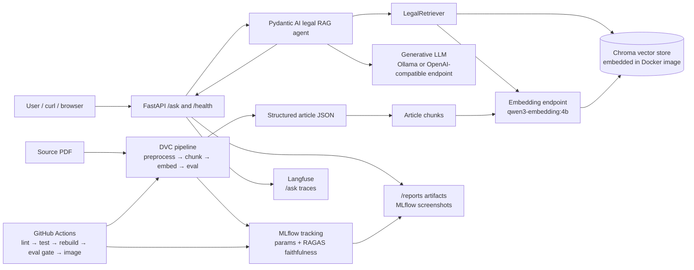

# Legal RAG · Egyptian Civil Code Q&A

RAG service for answering questions against the Egyptian Civil Code. The app serves a FastAPI `/ask` endpoint backed by a Chroma vector store built from article-level JSON extracted from the source PDF.

Answers cite Civil Code article numbers, not chunk IDs or page numbers.

## Quick Setup

### Prerequisites

Install Docker with Docker Compose. For inference, configure either:

- An OpenAI-compatible LLM and embedding provider, such as OpenRouter; or
- A local Ollama server reachable from Docker.

The embedding model is required because `/ask` embeds each question before searching the bundled Chroma index. It must be compatible with the model used to build that index. The bundled index uses `qwen3-embedding:4b`.

When using Ollama, keep it running on the configured port (`11434` by default) and install the required embedding model. `qwen3.5:4b` is the recommended local answer model:

```bash
ollama pull qwen3-embedding:4b
ollama pull qwen3.5:4b
ollama serve
```

If Ollama is already running, do not start a second `ollama serve` process.

### Automated Ollama setup

Run the setup script from the repository root:

```bash
./scripts/setup_ollama.sh
```

The script starts Ollama on port `11434` if needed, downloads `qwen3-embedding:4b` and `qwen3.5:4b`, and patiently warms each model with retries while Ollama loads it. Warm-up requests allow up to five minutes per attempt. It then creates `qwen3.5:4b-32k`, a derived model with a 32k-token context window: Ollama's 4096-token default is smaller than the 27-chunk RAG prompt, which truncates the structured answer and makes `/ask` fail with a token-limit error. The script writes the Docker-compatible Ollama settings to `.env` immediately after the downloads, verifies that both models are installed, and starts `docker compose up`. Existing unrelated `.env` values, including optional Langfuse credentials, are preserved. Only residency in `ollama ps` is not required: on GPUs that cannot hold both models at once, Ollama evicts one when the other is requested.

For manual or custom-provider setup, create `.env` from `.env.example`, then complete these three steps.

### 1. Configure the LLM

Choose one provider.

#### Local Ollama

The API runs in Docker, so use `host.docker.internal` rather than `localhost`. Pydantic AI uses Ollama's OpenAI-compatible `/v1` API:

```env
LEGRAG_LLM_BASE_URL=http://host.docker.internal:11434/v1
LEGRAG_LLM_MODEL=qwen3.5:4b
LEGRAG_LLM_API_KEY=ollama
```

#### OpenRouter

```env
LEGRAG_LLM_BASE_URL=https://openrouter.ai/api/v1
LEGRAG_LLM_MODEL=deepseek/deepseek-v4-pro
LEGRAG_LLM_API_KEY=<your-openrouter-api-key>
```

Any compatible provider may be used by setting its base URL, model name, and API key.

### 2. Configure embeddings

Choose the embedding endpoint that matches the bundled Chroma index.

#### Local Ollama

The embedding code uses Ollama's native `/api/embed` endpoint:

```env
LEGRAG_EMBEDDING_BASE_URL=http://host.docker.internal:11434/api/embed
LEGRAG_EMBEDDING_MODEL=qwen3-embedding:4b
LEGRAG_EMBEDDING_API_KEY=
```

#### OpenAI-compatible provider

```env
LEGRAG_EMBEDDING_BASE_URL=https://openrouter.ai/api/v1
LEGRAG_EMBEDDING_MODEL=<provider-model-compatible-with-the-index>
LEGRAG_EMBEDDING_API_KEY=<your-provider-api-key>
```

Do not use an arbitrary embedding model with the bundled index. If the embedding model changes, rebuild the index with the same model before querying it.

#### Optional Langfuse tracing

Langfuse is not required to run the API. To record `/ask` traces, configure:

```env
LANGFUSE_PUBLIC_KEY=<your-public-key>
LANGFUSE_SECRET_KEY=<your-secret-key>
LANGFUSE_BASE_URL=<your-langfuse-url>
```

Tracing is enabled only when both `LANGFUSE_PUBLIC_KEY` and `LANGFUSE_SECRET_KEY` are present. If either key is missing, the Langfuse integration is ignored and `/ask` continues normally without tracing.

### 3. Start the API

```bash
docker compose up
```

visit http://localhost:8000


## API

`POST /ask`

Request:

```json
{"question":"ما هي شروط العقد؟"}
```

Response:

```json
{
  "answer": "...",
  "sources": ["Egyptian Civil Code, Article 89"]
}
```

`sources` are article citations only.

`GET /health`

```json
{"status":"healthy","documents_indexed":1234}
```

`GET /reports/` serves project evidence files, including MLflow screenshots and architecture diagrams.


## Best MLflow Run

Best run selected from recent completed MLflow runs by sorting on RAGAS faithfulness.

- Experiment: `legrag-rag-eval`
- Run ID: `50445284e1124bfdbb187cdb82a45a76`
- Run URL: <https://mlflow.badribrahim.com/#/experiments/1/runs/50445284e1124bfdbb187cdb82a45a76/evaluations>
- RAGAS faithfulness: `0.8271666666666667`

Pinned configuration:

- Chunk size: `256`
- Chunk overlap: `64`
- Approx chars/token: `4.0`
- Embedding model: `qwen3-embedding:4b`
- Retrieval `top_k`: `27`
- Agent model: `deepseek/deepseek-v4-pro`
- Judge model: `openai/gpt-4o-mini`

The final local rebuild uses the same selected configuration and writes a clean Chroma collection named `egyptian_civil_code` under `data/chroma`.

## Architecture




## Reports

Current report artifacts:

- `reports/0-mlflow_experiments.png`
- `reports/1-best-run.png`
- `reports/2-registered-model.png`

Open them through:

```bash
open http://localhost:8000/reports/
```
